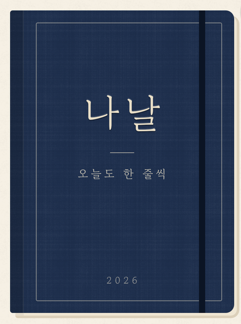

<div align="center">



# 나날

**불렛저널처럼 기호 하나로 적고, 하루 끝에 1분만 돌아보는 하루 기록 앱**

<p>
  
  
  
  
  
</p>

</div>

---

## 왜 만들었나

일반 노트는 옵시디언에 두지만, 휴대폰에서 동기화가 끊기면서 **하루 기록**도 함께 끊겼어요. 나날은 하루 기록만 맡는 작은 수첩이에요.

- **할 일을 놓치지 않는다**: 불렛저널(Ryder Carroll)의 빠른 기록과 옮기기(migration)를 따릅니다. 끝내지 못한 일은 매번 "오늘 할까, 미룰까, 안 할까"를 정해요.
- **돌아볼 거리를 쌓는다**: 기분과 회고를 구조화해 남겨서, 한 달 뒤에 패턴이 보이게 합니다.
- **놓친 날에도 부담이 없다**: 연속 기록(스트릭) 대신 줄어들지 않는 "기록한 날 N일"만 보여 줘요. 하루는 새벽 4시에 넘어갑니다.

## 이렇게 써요

### 🌅 아침: 넘어온 일 정리
어제까지 끝내지 못한 일이 날짜별 포스트잇으로 붙어 있어요. 하나씩 **오늘 하기**, **날짜 정해 미루기**, **안 하기**, **그날 했어요** 중에 골라요.

### ✏️ 낮: 기호 하나로 한 줄
앱을 열면 바로 적을 수 있어요. 종류를 고르고 한 줄 쓰면 끝입니다.

| 기호 | 뜻 |
|:-:|---|
| `•` | 할 일·약속 (누르면 진행 중 → 끝낸 일) |
| `–` | 메모: 생각, 느낌, 기억하고 싶은 것 |
| `◐` | 진행 중 |
| `✓` | 끝낸 일 (줄이 그어져요) |
| `›` | 다른 날로 옮긴 일 |
| ~~안 하기~~ | 지우지 않고 줄을 그어 남겨요 |
| 🖍️ | 형광펜: 오늘 중요한 일, 하루 3개까지 |

줄을 밀어서 미루기·안 하기·지우기를 하고, 길게 눌러 끌면 순서를 바꿔요. 날짜 없는 일은 **언젠가** 목록에 모아 둡니다.

### 🎙️ 말로 적기
말로 쏟아 놓으면 AI가 할 일과 메모로 나눠 줄로 정리해 줘요.

### 🌙 저녁: 1분 마무리
기분을 1~5로 고르고, 원하면 그날에 맞는 회고 틀 하나에 답해요(완벽주의가 올라온 날, 무기력했던 날, 감사한 날, 자유 일지). 모두 건너뛸 수 있어요.

### 📅 지난 기록과 월간 돌아보기
달력에서 기분이 잉크처럼 번져 보이고, 날짜를 누르면 그날의 줄과 회고를 다시 볼 수 있어요. 새 달이 되면 지난달을 정리하고, AI가 쓴 **월간 돌아보기** 한 장을 받아요. 할 일 내용은 AI에 보내지 않아요.

### 📱 위젯
홈 화면 위젯(오늘 할 일과 기분), 잠금 화면 위젯(다음 할 일과 남은 수), 제어 센터 버튼(바로 한 줄 적기, 말로 적기)을 제공해요.

## 설계 원칙

- **오프라인 우선**: 모든 기록은 기기의 SQLite에 먼저 저장되고, 연결되면 Supabase와 동기화돼요(outbox, last-write-wins).
- **데이터는 처음부터 구조화한다**: 기분 점수, 회고 틀, 할 일 상태를 모두 필드로 저장해요.
- **기록 도구이지 치료 도구가 아니다**: 회고 문구는 진단하거나 고치려 들지 않아요.

## 구조

```
nanal/
├── mobile/                  # Expo 앱
│   ├── src/
│   │   ├── screens/         # 오늘 · 저녁 · 지난 기록 · 월간 돌아보기 · 온보딩
│   │   ├── db/              # expo-sqlite 스키마·마이그레이션 (App Group 공유 폴더)
│   │   ├── sync/            # outbox → push / pull 동기화 엔진
│   │   ├── items/ days/ reflections/ someday/   # 도메인별 저장소
│   │   └── ai/ voice/       # 말로 적기, AI 정리
│   └── targets/widget/      # iOS 위젯·제어 센터 (SwiftUI, 같은 SQLite를 읽음)
├── supabase/
│   ├── migrations/          # Postgres 스키마 + RLS
│   ├── functions/           # Edge Functions: organize-voice · monthly-review · delete-account
│   └── tests/               # pgTAP 테스트
├── scripts/                 # TestFlight · Google Play 업로드
└── docs/                    # 설계 문서, 개인정보 처리방침, Android 배포 안내
```

## 개발 시작하기

```sh
cd mobile
npm ci
cp .env.example .env        # EXPO_PUBLIC_SUPABASE_URL, EXPO_PUBLIC_SUPABASE_ANON_KEY 채우기

npm run ios                 # iOS 시뮬레이터 (개발 빌드)
npm run android             # Android 에뮬레이터 (JDK 17 · Android SDK 필요)
```

로컬 백엔드가 필요하면 다음을 실행해요.

```sh
supabase start              # Studio: http://localhost:54323
supabase test db            # RLS · 마이그레이션 테스트
```

### 테스트

```sh
cd mobile
npm test                    # Jest (동기화, 날짜 계산, 규칙 등)
npm run typecheck
```

## 배포

| 대상 | 명령 | 참고 |
|---|---|---|
| TestFlight | master에 push하면 자동 ([워크플로](.github/workflows/testflight.yml)) | 빌드 번호는 자동으로 정해요. 건너뛰려면 커밋 메시지에 `[skip testflight]`. 손으로 올릴 땐 `scripts/upload-testflight.sh` |
| Google Play 내부 테스트 | `scripts/upload-play.sh` | `android.versionCode`를 먼저 올려요. 처음 준비는 [docs/release-android.md](docs/release-android.md) |

## 라이선스

[MIT](LICENSE) © hyorish03
